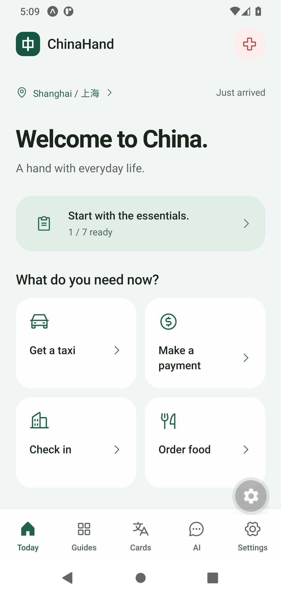
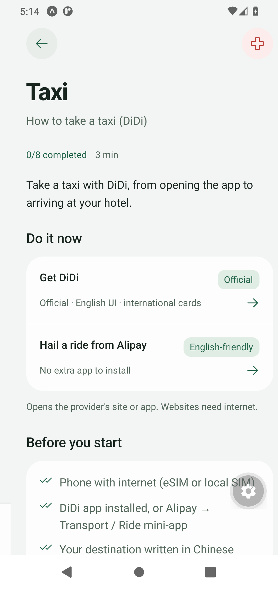
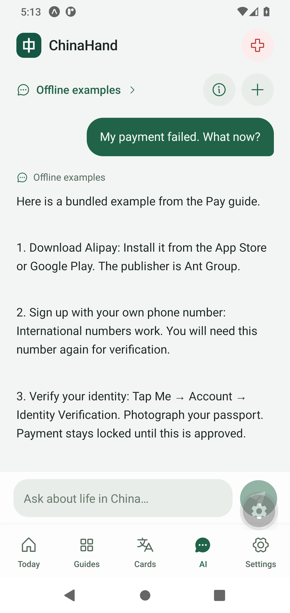
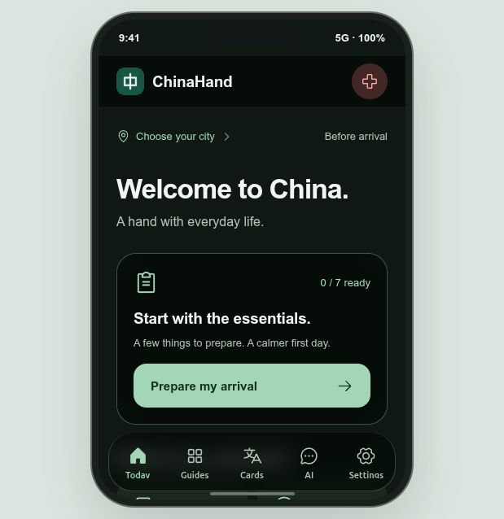
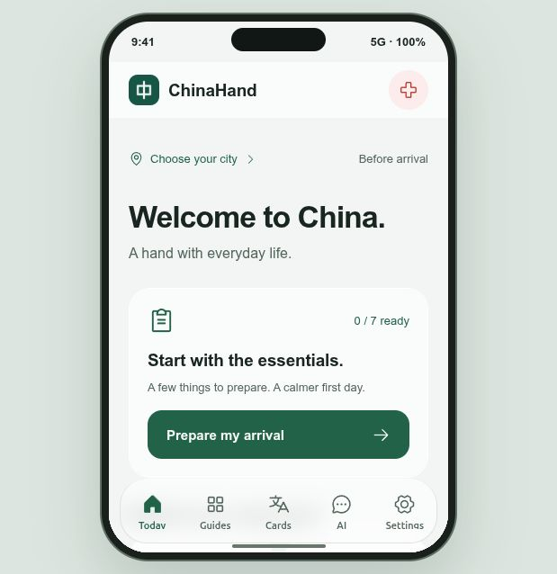
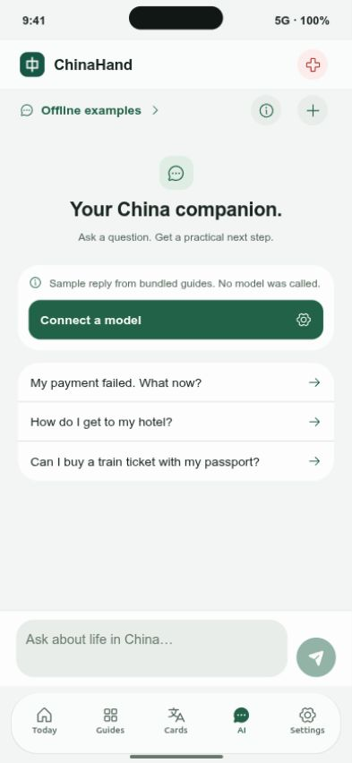

# ChinaHand 原生手机应用演示

## 设计判断

Reading this as: a native mobile companion for international visitors to China, with a calm iOS-inspired visual language, guided by Apple HIG.

本次为视觉和应用形态重构。参数为 DESIGN_VARIANCE 5、MOTION_INTENSITY 4、VISUAL_DENSITY 4。项目已有深绿色品牌色、圆角“中”字图标、系统无衬线字体、按任务分组的场景内容。本次延续品牌资产，采用原生安全区域、大标题、分组列表、全屏中文卡片、底部导航和设置页。

用户明确要求从网页 Demo 改为手机应用演示，因此新的应用导航改为 Today、Guides、Cards、AI、Settings 五个入口。原有网页路由仍保留在旧 Demo 中。启动页和欢迎页用于建立品牌与解释三个核心动作：查看步骤、展示中文、询问助手。

调用 design-taste-frontend 的适用规则：品牌审核、统一色彩与圆角、字体层次、文案检查、状态反馈、明暗主题和减少动态效果。该技能明确将原生移动应用列为范围之外，所以原生交互使用 [Apple iOS HIG](https://developer.apple.com/design/human-interface-guidelines/designing-for-ios)；营销页 hero、照片要求、SEO、Lighthouse 等检查在此次原生应用中不适用。

## 视觉规则

- 绿色作为唯一品牌强调色，红色仅用于紧急或错误的语义反馈。
- 全应用统一浅色或深色主题。默认为跟随系统，也可手动切换。
- 主字体使用平台系统字体。iPhone 使用 iOS 的原生系统字体。
- 分组容器 24pt 圆角，输入与按钮 14-16pt，小型图标按钮为圆形。消息气泡另用方向性圆角表达发送方。
- 通常按钮至少 44pt，主要操作至少 54pt。字体支持系统缩放。
- 卡片上的中文属于展示给对方的内容，不受界面语言切换影响。
- 点击缩放表达按下反馈；首次进入淡入表达启动状态转换。开启“减少动态效果”后停用这些动效。
- 图标使用 Phosphor React Native，按图标导入以减少包体。使用已有品牌 PNG，不绘制新的装饰 SVG，不使用网页套壳。

## AI 接入设计

API 设置与聊天使用内存状态。持久化只允许偏好设置、清单、指南进度、收藏、自写卡片和地址。每次请求前构建项目说明、相关场景知识与用户允许的使用环境。城市来自用户手动选择，不假装获得定位。

API Key 仅进入 Authorization 请求头。提供明示的服务商发送说明和同意开关；用户可预览上下文、关闭旅程信息共享或断开会话。OpenAI Responses 设置 store:false；DeepSeek 和 Qwen 使用原生 streaming fetch + Chat Completions。

现有指南的内容复核日期仍为原始日期，界面重设计不等于政策内容重新验证。项目不提供实时订票、支付、紧急调度或联网资料检索。没有 Key 时仅展示带标签的离线示例。

## 验证记录

验证内容包括：类型检查、lint、Expo 依赖兼容性、两端原生 JS/Hermes 导出、SSE 分段与中文解码、三家请求格式、Qwen 区域端点、失败/超时/停止、上下文隐私和持久化白名单。

2026-10-14 继续迭代：类型检查、lint、16 项适配器、隐私和服务入口测试，以及 Android/iOS Hermes 导出均通过；同步 Expo 兼容补丁后，Expo Doctor 21 项检查通过。模型官方文档已重新核对，现有模型 ID 仍适用。

目前为设计与交互 Demo 阶段，通过 Expo Go 运行原生界面。本次交付为可验证的交互 Demo，不生成 APK 或独立 iOS 安装包。已在 Android 模拟器中检查欢迎页、城市与阶段选择、准备清单、指南入口、中文卡片收藏及复制、明暗主题、离线回答、上下文共享和会话重启。服务入口实际打开系统浏览器；电话入口仅打开系统拨号界面，不在演示中拨出电话。iOS 已通过原生 Hermes 导出，未在此 Linux 环境运行 iOS 模拟器。

没有使用用户的服务商 Key，因此适配器使用模拟响应验证；真实账号权限、余额和网络可达性由应用中的“测试连接”验证。

## 最新服务入口适配

已接入上游 `d9266ea` 的服务跳转更新，九个指南共 21 条入口。保留官方、英文友好、中文界面、拨打四类标识和原有使用条件。机场、车站通过名称打开高德搜索，不编造坐标或导航路线。AI 的相关指南上下文也包含这些入口及其限制。

补充运行验证：Qwen 新加坡端点随区域切换，重新打开设置可恢复当前会话；模拟器进程重启后回到离线示例模式，准备清单进度仍保留。110 入口已确认打开系统拨号界面并填入号码，未拨出电话。

## 原生运行截图

以下为 Android 模拟器中 Expo Go 的实际运行截图，浮动齿轮属于 Expo Go 宿主。

| Today | 服务入口 | AI 离线示例 |
| --- | --- | --- |
|  |  |  |

## Windows 与 iOS 材质迭代

启动入口已改为跨平台 Node 脚本，Windows 可以双击 `Start-ChinaHand.cmd`，也可运行 `npm run demo:ios`。桌面预览复用 React Native 界面，通过 iPhone 尺寸框架展示交互，不声称运行 Apple iOS 模拟器。

导航使用浮动玻璃材质，iOS 可用时选择 Expo GlassEffect 的系统 Liquid Glass，旧版本使用 BlurView，Android 使用实色回退；浏览器使用毛玻璃近似。页面切换增加短弹簧位移，按压增加回弹，保留减少动态效果和减少透明度支持。未在 Linux 上声称验证 Apple 原生材质的实际渲染。

本轮已在桌面预览中实际检查欢迎页、首页、聊天输入与离线回答、浅色与深色材质，确认浮动导航不会遮挡聊天输入框。Windows 启动器已消除 Bash 依赖，但当前主机为 Linux，未声称在 Windows 实机运行验证。Expo Doctor 21 项通过，两端原生和桌面静态导出通过。

已合入最新上游 `cf70292`，保留原 Demo 新增的口岸落地流程，并同步原生城市资料至 8 个城市。

## 手机字号与聊天首页密度调整

参考 [DeepSeek 官方手机界面截图](https://www.deepseek.com/images/download/mobile-en-606.webp) 的视觉比例，采用较小的居中欢迎区和紧凑工具栏。以下为 ChinaHand 自选尺寸，并非官方公开字号规范：聊天欢迎标题 22/28、普通页面标题 28/34、正文 15/22、说明 12/18；常规图标约 19-21，品牌图标 28。图标按钮保留 44 点点击区域。

连接说明与连接按钮合并为一个面板，建议问题列表行距缩短，输入与发送控件同步缩小；保留系统字体缩放。已在 393×852 手机布局检查三条建议问题可见、输入框与导航标签完整，并实际点击建议问题获得离线示例。

