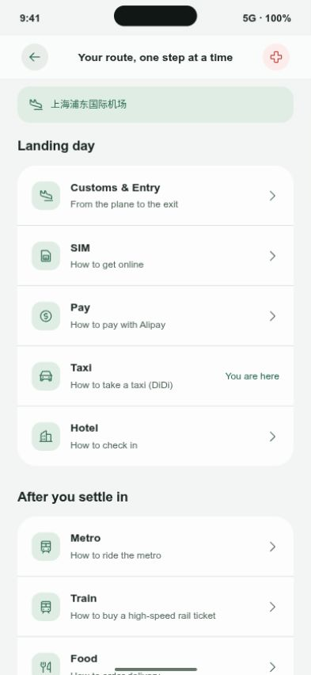

# 2026-10-14 更新审查与原生适配

审计日期按上海时间 10 月 14 日全天，截至远端 `main` 的 `77f4541`，共 8 个提交。跨午夜后的 10 月 15 日再次拉取时，尚无其他新增远端提交。

| 提交 | 改动 | 原生项目适配 |
| --- | --- | --- |
| `606b030` | 外链自检脚本 | 保留；补充原生内容 JSON 的服务与城市来源 URL；每次请求独立超时 |
| `81dadb5` | 九个指南“直接去办”，城市地图搜索，四个拨号入口 | 原生 21 条入口保留四种徽章和使用条件；HTTPS、tel 分开验证；首页也有四个电话入口 |
| `d9266ea` | 合并日语、韩语场景正文覆盖和外链面板 | 九个场景和卡片释义保留；新口岸、流程标签复用四语原始文案 |
| `1609d9e` | ChinaHand 原生应用与单次 AI 会话 | 原生五个入口、欢迎页、三家模型适配；API Key 只在内存 |
| `a6d8720` | 15 个口岸，落地流程定位，网页底部四屏导航，开放全部城市 | 新增原生口岸选择、中文展示、落地流程和“当前任务”；8 城市完整；原生五页中保留 AI 和设置，将流程纳入指南入口 |
| `cf70292` | 合并原生 Demo 和改名 | 保留上游历史与网页、原生两个实现 |
| `b064d9f` | Windows 启动、iPhone 预览、玻璃与动画 | 补齐 Linux 可执行启动脚本；依赖与端口自动检查；默认浏览器自动打开 |
| `77f4541` | 手机字号和聊天欢迎布局 | 保留紧凑字号；卡片列表英文大字，打开后中文大字，操作图标进一步缩小 |

## 适配边界

- 口岸列表是已有项目的常用口岸数据，不代表完整列表或签证、免签资格。
- 口岸映射城市时处理 `Xi’an` 与 `Xi'an` 的拼写差异。无城市资料的口岸保留中文名，明确提示资料未编写，不编造机场或车站。
- 手动改选城市会清除口岸；选择未知资料城市的口岸会清除此前城市，避免旧城市被误用。
- 打开流程任务只定位当前任务，不自动把指南步骤标记完成。
- API Key、配置和草稿只在内存；后台、页面退出、往返缓存恢复、断开连接均清除。偏好持久化只包含明确白名单。
- 后续提交作者和提交者使用已验证的 Yunk-S GitHub 身份，并通过其现有 SSH 认证推送。

## 启动

Windows：安装 Node.js 22.13+ 后双击 `Start-ChinaHand.cmd`。

Linux：运行 `./Start-ChinaHand.sh`。首次缺少依赖时自动安装；锁文件变化时更新依赖；端口占用时选择下一个端口；服务准备好后打开默认浏览器。

启动器提供桌面 iPhone 布局交互预览，并启动 Expo Go 的 iPhone/Android 原生开发服务。桌面预览不是 Apple iOS 模拟器。Windows 实机和原生 iOS 实机尚未在本机验证。

## 本轮验证

- Linux 快捷脚本已实际启动服务，并在服务就绪后自动打开默认浏览器；保留局域网 Expo Go 服务。
- 口岸选择器实际显示 15 个口岸；搜索 `PVG` 选中浦东后关联上海。
- 香港西九龙选择后明确显示暂无城市资料，保留中文展示和地图搜索入口。
- 从落地流程打开 Taxi 再返回，显示“当前任务”，指南仍为 0/8 步，未伪造完成进度。
- 虚拟 API Key 连接后，离开页面再返回，Key 输入与连接配置清空。
- 卡片列表英文大字，打开后中文大字已实际检查。

